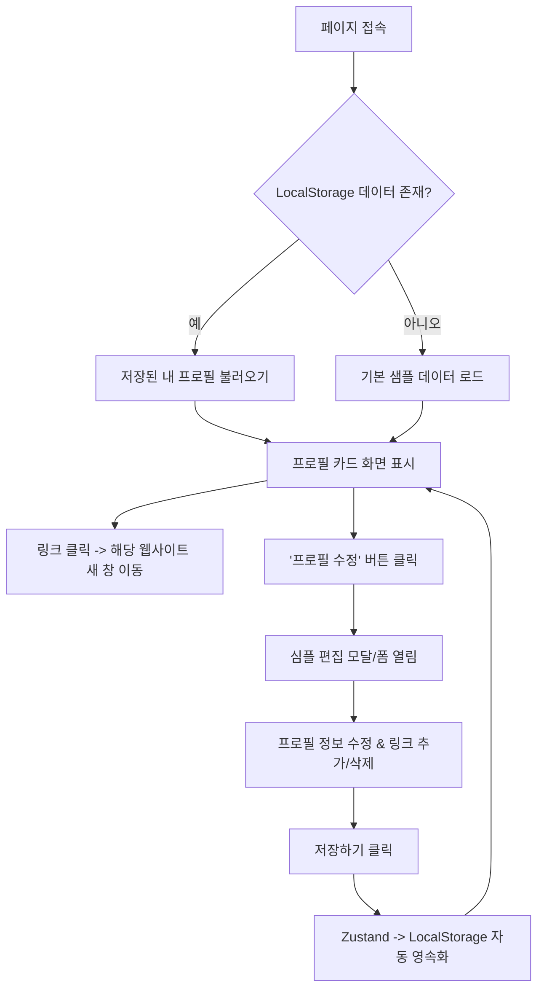

# [PRD] 로컬 스토리지 기반 프로필 페이지 "마이링크 (MyLink)" 기능 정의서

---

| 항목 | 내용 |
| :--- | :--- |
| **프로젝트명** | 마이링크 (MyLink) — 프로필 페이지 단계 |
| **버전** | v0.1.0 (학습 & 프로필 페이지 MVP) |
| **작성일** | 2026-11-09 |
| **기반 스택** | Next.js 16, React 19, TypeScript, Tailwind CSS v4, shadcn/ui (Neobrutalism Theme), Zustand |
| **데이터 스토리지** | 브라우저 `localStorage` (Zustand `persist` 활용) |
| **현 단계 목표** | 대시보드/통계 없이 **로컬 스토리지로 상태가 유지되는 깔끔한 프로필 페이지** 완성 |

---

## 1. 프로젝트 목표 및 방향 (Goals & Scope)

### 1.1 기획 목표
- Next.js 16과 React 19, Tailwind CSS v4, shadcn/ui, Zustand를 학습하며 **단계별로 프로필 링크 페이지를 직접 구현**합니다.
- 대시보드나 통계 분석, 복잡한 URL 공유 등의 무거운 기능은 배제하고, **"내 브라우저에서 안전하게 수정되고 영구 저장되는 완성도 높은 프로필 카드"**를 만듭니다.

### 1.2 이번 단계 범위 (Scope)
- ✅ **포함 기능**:
  - 프로필 카드 렌더링 (아바타, 이름, 뱃지, 소개글, 링크 버튼 목록, 소셜 아이콘)
  - Zustand `persist` 기반의 `localStorage` 자동 저장 및 불러오기
  - 심플 편집 기능 (프로필 텍스트 수정, 링크 추가/수정/삭제)
  - 반응형 디자인 (모바일 최적화 및 데스크톱 지원)
  - shadcn/ui 기반 네오브루탈리즘(Neobrutalism) 스타일 디자인 시스템 구축 (굵은 2~3px 검은 테두리, 하드 섀도우, 촉각적 클릭 애니메이션, 레트로 비비드 팔레트)
- ❌ **제외 기능 (추후 단계로 연기)**:
  - 방문자 통계 / 클릭 수 분석 차트
  - 복잡한 관리자 대시보드 및 분할 화면
  - 외부 백엔드 데이터베이스 및 사용자 로그인

---

## 2. 사용자 플로우 및 시나리오 (User Journey & Scenarios)

### 2.1 사용자 플로우 (User Flow)



### 2.2 사용자 시나리오 (User Scenarios)

#### 👥 관점 1. 방문자 시나리오 (Visitor Perspective)
*목표: 다른 사람의 마이링크 페이지를 방문하여 프로필을 확인하고 원하는 링크로 안전하게 이동한다.*

- **1단계 (페이지 접속)**: 사용자는 크리에이터의 소셜 미디어(인스타그램, 깃허브 등) 프로필에 등록된 마이링크 주소를 확인하기 위해 해당 링크를 클릭한다.
- **2단계 (프로필 탐색)**: 사용자는 크리에이터의 직무와 현재 상태 및 소개글을 파악하기 위해 화면 상단의 프로필 사진, 이름, 역할 뱃지, 바이오(Bio)를 한눈에 살펴본다.
- **3단계 (링크 목록 탐색)**: 사용자는 자신이 방문하고자 하는 목적지(포트폴리오, 기술 블로그, 대표 프로젝트 등)를 찾기 위해 깔끔하게 정렬된 링크 버튼 목록을 스크롤하여 탐색한다.
- **4단계 (목적지 이동)**: 사용자는 관심 있는 콘텐츠로 이동하기 위해 해당 링크 버튼을 클릭하여 새 탭에서 대상 웹사이트를 확인한다.
- **5단계 (소셜 채널 연동)**: 사용자는 크리에이터와 직접 소통하거나 다른 소셜 채널을 팔로우하기 위해 하단의 소셜 아이콘 바(GitHub, Instagram, Email 등)를 클릭한다.

---

#### 👤 관점 2. 소유자 시나리오 (Owner Perspective)
*목표: 자신의 마이링크 프로필 정보와 링크 목록(추가, 수정, 삭제)을 관리하고 변경 사항을 로컬 스토리지에 영구 보관한다.*

- **1단계 (편집 모드 진입)**: 사용자는 자신의 프로필 정보와 링크들을 관리하기 위해 화면의 `[⚙️ 프로필 편집]` 플로팅 버튼을 클릭한다.
- **2단계 (기본 정보 수정)**: 사용자는 최근 갱신된 본인의 직무나 소개글을 반영하기 위해 편집 모달에서 이름, 직무 뱃지, 소개 텍스트, 프로필 이미지 URL을 입력 및 수정한다.
- **3단계 (새 링크 추가)**: 사용자는 새롭게 공개한 프로젝트나 최신 블로그 글을 방문자에게 알리기 위해 `[+ 새 링크 추가]` 버튼을 누르고 링크 제목, URL, 아이콘 이모지를 등록한다.
- **4단계 (기존 링크 수정)**: 사용자는 변경된 웹사이트 주소나 오타가 있는 링크 제목을 바로잡기 위해 기존 링크 입력란의 텍스트와 URL을 수정한다.
- **5단계 (불필요한 링크 삭제)**: 사용자는 더 이상 운영하지 않거나 오래된 링크를 정리하기 위해 해당 항목 옆의 `[삭제]` 버튼을 클릭한다.
- **6단계 (소셜 링크 갱신)**: 사용자는 방문자가 본인에게 연락할 수 있는 채널을 제공하기 위해 GitHub, Instagram, Email 등의 소셜 주소를 입력한다.
- **7단계 (저장 및 로컬 스토리지 영속화)**: 사용자는 수정한 모든 설정을 현재 브라우저에 저장하고 다음 방문 시에도 동일하게 유지하기 위해 `[저장하기]` 버튼을 클릭한다.
- **8단계 (초기화 및 복구 - 부가)**: 사용자는 잘못 입력된 정보를 지우고 처음의 깔끔한 기본 템플릿으로 되돌리기 위해 `[기본값으로 되돌리기]` 버튼을 클릭한다.

---

## 3. 핵심 아키텍처 및 디자인 시스템

| 구분 | 기술 결정 | 상세 설명 |
| :--- | :--- | :--- |
| **프레임워크** | Next.js 16 (App Router) + React 19 | 최신 리액트 클라이언트 컴포넌트 활용 |
| **스타일링 원칙** | **Tailwind CSS v4 전면 통일 (모듈 CSS 배제)** | CSS 모듈(`.module.css`)은 일절 사용하지 않으며, Tailwind CSS 유틸리티 클래스와 `globals.css`의 `@theme inline`으로 100% 통일 |
| **컴포넌트 시스템** | **shadcn/ui 기반 모듈화 & 재사용 컴포넌트** | `src/components/ui/`에 `Card`, `Button`, `Badge`, `Avatar`, `Input`, `Separator` 등을 모듈화하여 모든 화면에서 재사용 |
| **디자인 시스템** | Neobrutalism 테마 (`design.md` 준수) | `design.md`의 네오브루탈리즘 원칙(굵은 검은 테두리, 하드 섀도우, 촉각적 클릭감, 비비드 팔레트)을 shadcn/ui 프리미티브에 엄격 적용 |
| **상태 관리** | Zustand | 초경량 전역 상태 관리 (`useProfileStore`) |
| **데이터 영속화** | `persist` 미들웨어 (LocalStorage) | 새로고침하거나 브라우저를 닫아도 데이터가 유지됨 (`mylink_profile_data`) |

### 3.1 스타일링 및 컴포넌트 아키텍처 원칙 (Styling & Component Principles)
1. **모듈 CSS 배제 & Tailwind CSS 단일화**:
   - 컴포넌트 단위의 별도 `.module.css` 파일을 작성하지 않고, 유지보수성과 스타일 일관성을 위해 Tailwind CSS v4 단일 체계로 통일합니다.
2. **shadcn/ui 기반 컴포넌트 재사용성 극대화**:
   - 화면 구성 시 임의의 `div`나 기본 HTML 태그를 중복 정의하는 대신, `src/components/ui/`에 shadcn/ui 규격으로 제작된 프리미티브 컴포넌트를 조립하여 사용합니다.
   - 컴포넌트 목록:
     - `Card` / `CardHeader` / `CardTitle` / `CardDescription` / `CardContent` / `CardFooter`
     - `Button` (다양한 variants 및 Neobrutalism 클릭 애니메이션)
     - `Badge` (상태, 역할, 카테고리 태그용)
     - `Avatar` / `AvatarImage` / `AvatarFallback` (원형 테두리, 하드 섀도우, 온라인 인디케이터)
     - `Input` (Neobrutalism 테두리 & 포커스 하드 섀도우 입력 필드)
     - `Separator` (순수 블랙 분할선)
3. **`design.md` 기반 디자인 토큰 엄격 준수**:
   - 모든 shadcn/ui 컴포넌트와 페이지는 `design.md`에 명시된 테두리(`border-black`), 하드 그림자(`shadow-[x_y_0px_#000000]`), 촉각적 인터랙션 및 팔레트를 그대로 따릅니다.

### 3.2 네오브루탈리즘 디자인 토큰 요약 (`design.md` 연계)
- **테두리 (Borders)**: 투명도 없는 순수 블랙(`border-black`), 2px(컴포넌트) ~ 3px(카드/모달)
- **하드 그림자 (Hard Shadows)**: 블러 없는 오프셋 그림자
  - 버튼/인풋: `shadow-[3px_3px_0px_#000000]`
  - 카드/모달: `shadow-[6px_6px_0px_#000000]`
  - 뱃지/스티커: `shadow-[2px_2px_0px_#000000]`
- **촉각적 인터랙션 (Tactile Interactions)**:
  - Hover: `translate-x-[1.5px] translate-y-[1.5px] shadow-[1.5px_1.5px_0px_#000000]`
  - Active: `translate-x-[3px] translate-y-[3px] shadow-none`
- **시그니처 팔레트**:
  - Canvas: `#FFFBEB` (레트로 크림)
  - Card / Primary: `#FEF08A` (시그니처 옐로우)
  - Secondary: `#BAE6FD` (스카이블루)
  - Accent / Badge: `#A7F3D0` (민트그린)
  - Destructive: `#F87171` (레드)
  - Border / Text: `#000000` (순수 블랙)

> [!NOTE]
> Tailwind CSS v4의 CSS-first 아키텍처에 따라 별도의 `tailwind.config.*` 파일 없이 `src/app/globals.css`의 `@theme inline` 및 CSS 변수에서 Neobrutalism shadcn/ui 테마를 중앙 집중식으로 관리합니다.

---

## 4. 세부 기능 요구사항 (Functional Requirements)

### FR-01: 프로필 카드 화면 (Profile View)
1. **아바타 (프로필 이미지)**:
   - 프로필 이미지 표시 (원형, 검은색 굵은 테두리 및 그림자)
   - 이미지 URL 입력 방식 또는 기본 이모지 지원
2. **이름 및 역할 뱃지**:
   - 사용자 이름/닉네임 표시
   - 펄스(Pulse) 점이 있는 직무/상태 뱃지 (예: `Frontend Developer`, `✦ OPEN TO WORK`)
3. **소개글 (Bio)**:
   - 멀티라인 자기소개 텍스트 표시
4. **링크 버튼 목록**:
   - 각 링크의 아이콘(이모지), 제목, 바로가기 화살표(`↗`)가 포함된 인터랙티브 버튼
   - 클릭 시 `target="_blank" rel="noopener noreferrer"`로 외부 페이지 열림
   - 마우스 호버(Hover) 및 클릭(Active) 시 쫀득한 입체감 애니메이션
5. **소셜 링크 아이콘 바**:
   - GitHub, Instagram, YouTube, 이메일 등의 아이콘 버튼 제공

---

### FR-02: 프로필 & 링크 심플 편집 (Simple Editor)
*복잡한 대시보드 대신, 프로필 페이지 내에서 직관적으로 다룰 수 있는 심플한 편집 UI를 제공합니다.*

1. **편집 진입**:
   - 프로필 카드 상단 또는 우측 하단에 `[⚙️ 프로필 편집]` 플로팅 버튼 제공
   - 클릭 시 깔끔한 슬라이드 패널 또는 모달 형태로 편집 폼 오픈
2. **편집 항목**:
   - **내 정보**: 이름, 뱃지 문구, 소개글, 프로필 이미지 URL
   - **링크 관리**:
     - 기존 링크의 제목, URL 수정
     - `+ 새 링크 추가` 버튼으로 손쉬운 항목 추가
     - 각 링크별 `삭제` 버튼
   - **소셜 링크**: GitHub, Instagram, Email 주소 입력
3. **저장 및 초기화**:
   - `저장하기`: 수정 사항 즉시 반영 및 LocalStorage 동기화
   - `기본값으로 되돌리기`: 언제든 초기 샘플 상태로 리셋 가능

---

### FR-03: LocalStorage 동기화 (Persistence)
- **키 이름**: `mylink_profile_data`
- **Hydration Safe**: Next.js SSR 환경에서 깜빡임(Hydration Mismatch)이 발생하지 않도록 마운트 완료 후 안전하게 렌더링 (`useMounted` 활용)

---

## 5. 메인 화면 와이어프레임 (UI Wireframe)

방문자가 모바일/웹 브라우저를 통해 마이링크 페이지에 접속했을 때 보게 되는 단독 프로필 카드 뷰입니다.

```text
+-------------------------------------------------------------+
|                     [ 📱 모바일 뷰포트 ]                    |
+-------------------------------------------------------------+
|                                                             |
|   +-----------------------------------------------------+   |
|   |                  [ ✦ OPEN TO WORK ]                 |   |  <- 상단 뱃지/스티커
|   |                                                     |   |
|   |                    /-----------\                    |   |
|   |                   |  [아바타]  | (● 활동중)         |   |  <- 프로필 사진 (원형/테두리)
|   |                    \-----------/                    |   |
|   |                                                     |   |
|   |                      권 용 대                       |   |  <- 이름 (Heading)
|   |             [ ● Frontend Developer ]                |   |  <- 직무/역할 뱃지
|   |                                                     |   |
|   |     직관적인 사용자 경험과 클린 코드를 지향하는     |   |  <- 소개글 (Bio)
|   |     웹 개발자입니다. 새로운 기술을 탐구하고         |   |
|   |     일상의 가치를 높이는 서비스를 만듭니다.         |   |
|   |                                                     |   |
|   |  ================= [ 링크 목록 ] =================  |   |
|   |                                                     |   |
|   |  +-----------------------------------------------+  |   |
|   |  | [🐙]  GitHub 방문하기                     [↗] |  |   |  <- 링크 버튼 (아이콘+제목+화살표)
|   |  +-----------------------------------------------+  |   |
|   |                                                     |   |
|   |  +-----------------------------------------------+  |   |
|   |  | [⭐]  my-Link-k 프로젝트 저장소           [↗] |  |   |
|   |  +-----------------------------------------------+  |   |
|   |                                                     |   |
|   |  +-----------------------------------------------+  |   |
|   |  | [📝]  기술 블로그 (개발 회고 & 노하우)    [↗] |  |   |
|   |  +-----------------------------------------------+  |   |
|   |                                                     |   |
|   |  +-----------------------------------------------+  |   |
|   |  | [📬]  협업 및 문의하기                    [→] |  |   |
|   |  +-----------------------------------------------+  |   |
|   |                                                     |   |
|   |  -------------------------------------------------  |   |
|   |                                                     |   |
|   |          [GitHub]    [Instagram]    [Email]         |   |  <- 소셜 아이콘 바
|   |                                                     |   |
|   |       [#React]  [#Next.js]  [#Tailwind]  [#UX]      |   |  <- 키워드 태그
|   +-----------------------------------------------------+   |
|                                                             |
+-------------------------------------------------------------+
```

---

## 6. 데이터 모델 정의 (TypeScript Schema)

### 6.1 핵심 인터페이스 (`src/types/index.ts`)

```typescript
export interface LinkItem {
  id: string;
  title: string;
  url: string;
  icon?: string; // 이모지 또는 아이콘 식별자 (예: '🐙', '⭐', '📝', '📬')
  description?: string;
  category?: string;
  createdAt?: string;
  isPinned?: boolean;
}

export interface SocialLinks {
  github?: string;
  instagram?: string;
  youtube?: string;
  email?: string;
  linkedin?: string;
  blog?: string;
}

export interface ProfileData {
  name: string;
  badge: string;
  bio: string;
  avatarUrl: string;
  links: LinkItem[];
  socials: SocialLinks;
  tags?: string[];
}
```

### 6.2 더미 데이터 명세 및 활용 (`src/data/dummyLinks.ts`)

프로젝트의 초기 화면 렌더링, Zustand 스토어 기본값, 그리고 향후 링크 목록 확장/필터링 기능 검증을 위해 모듈화된 더미 데이터를 사용합니다.

| 상수명 | 타입 | 항목 수 | 용도 및 설명 |
| :--- | :--- | :--- | :--- |
| **`INITIAL_LINKS`** | `LinkItem[]` | 4개 | 프로필 카드 화면의 기본 노출 링크 (GitHub, 저장소, 기술 블로그, 협업 문의) |
| **`DUMMY_LINKS`** | `LinkItem[]` | 10개 | 카테고리별 필터링, 정렬, 검색, 페이지네이션 및 링크 추가/삭제 테스트용 풍부한 샘플 데이터 |
| **`LINK_CATEGORIES`** | `readonly string[]` | 7개 | `['전체', '개발', '프로젝트', '블로그', '포트폴리오', '소셜', '연락처']` 카테고리 분류 상수 |
| **`DEFAULT_PROFILE_DATA`** | `ProfileData` | 1개 | 프로필 정보(이름, 소개, 뱃지, 아바타, 태그), 소셜 링크, `INITIAL_LINKS`를 포함한 기본 완성형 데이터 |

> [!NOTE]
> - **초기 로드 및 상태 영속화**: 사용자가 처음 방문했거나 브라우저 스토리지 데이터가 없을 때 `DEFAULT_PROFILE_DATA`를 로드하여 즉시 완전한 UI를 표시합니다.
> - **초기화(Reset) 기능 연계**: `FR-02`의 `[기본값으로 되돌리기]` 기능 실행 시 `DEFAULT_PROFILE_DATA`로 상태를 즉시 복원합니다.
> - **단일 진입점(Barrel Export)**: `src/data/index.ts`를 통해 `@/data`에서 바로 필요한 더미 데이터와 상수를 임포트하여 사용합니다.

---

## 7. 단계별 학습 & 구현 로드맵 (Learning Roadmap)

- [x] **Step 1: 데이터 타입 정의 및 더미 데이터 / Zustand 스토어 구축**
  - `src/types/index.ts`에 `ProfileData`, `LinkItem`, `SocialLinks` 타입 정의 완료
  - `src/data/dummyLinks.ts`에 더미 데이터(`INITIAL_LINKS`, `DUMMY_LINKS`, `DEFAULT_PROFILE_DATA`) 구성 완료
  - `src/store/useProfileStore.ts` 생성 (`zustand/middleware`의 `persist` 적용, `DEFAULT_PROFILE_DATA` 초기값 연동)
- [x] **Step 2: 네오브루탈리즘 shadcn/ui 컴포넌트(`Card`, `Avatar`, `Badge`, `Button`, `Input`, `Separator`) 모듈화 & 스토어 연결**
  - 모듈 CSS 배제 및 Tailwind CSS 단일화 원칙 적용
  - shadcn/ui 프리미티브 컴포넌트를 `design.md`의 네오브루탈리즘 테마(`border-black`, `shadow-[x_y_0px_#000]`, 촉각적 인터랙션)로 구축 및 모듈화
  - `page.tsx` 및 `links/page.tsx`에서 shadcn/ui 컴포넌트를 재사용하여 링크 목록 페이지 구축
  - Zustand 스토어의 상태를 구독하여 화면에 동적으로 렌더링
  - SSR Hydration 방지를 위한 마운트 체크 (`useMounted`)
- [ ] **Step 3: 네오브루탈리즘 shadcn/ui 모달(Dialog) 기반 심플 편집기 제작**
  - `[⚙️ 프로필 편집]` 플로팅 버튼 및 shadcn/ui `Dialog` 기반 모달 레이아웃 구현
  - shadcn/ui `Input`, `Textarea`, `Label`, `Button`을 네오브루탈리즘 스타일로 조합한 입력 폼
  - 링크 추가 / 수정 / 삭제 인터페이스
  - 변경 시 스토어 액션 호출 (`updateProfile`, `addLink`, `removeLink`, `resetToDefault`)
- [ ] **Step 4: 인터랙션 및 완성도 다듬기**
  - shadcn/ui 토스트 피드백 연동
  - 모바일 반응형 뷰 및 디자인 시스템 테마 토큰 일관성 점검
